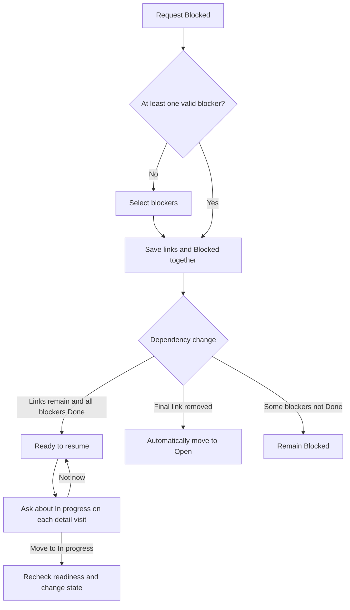

# Blocked work and dependency links

Requirement update · November 9, 2026. Supplements the [design guide](design_guide.md) and [implementation plan](../todo/pending/initial_implementation.md).

## Three different outcomes

| Situation | Result | User experience |
| --- | --- | --- |
| Request Blocked with no Blocked by links | Cannot enter Blocked yet | Choose blockers; save links and state together |
| Blocked, links remain, some blockers not Done | Remains Blocked | Show blocker count and individual states |
| Blocked, nonempty blocker set all Done | Remains Blocked until explicitly resumed | Ready to resume indicator; ask about In progress each detail visit |
| Blocked, final Blocked by link removed | Automatically becomes Open | All blockers removed — moved to Open; no resume prompt |

## Link language

On dependent PLAN-21, show **Blocked by PLAN-24**. On PLAN-24, show **Blocks PLAN-21**. These describe one directed link, not two independent relationships. Support multiple blockers/dependents and different sprints within the same project. Parent, Child and Related retain their existing behavior.

Cancelled items cannot be selected as blockers; cancellation removes their blocker edges. Done items can remain linked. Self-dependencies, duplicate edges and dependency cycles are rejected as implementation defaults.

## Entering Blocked

State pickers, board drag/menu, list actions, create/edit, REST and MCP enforce the same rule. If no valid blocker is already linked, show [Move item to Blocked](33-block-item/design.md). The multi-select includes each target's key, title, state and sprint/Backlog.

Primary action: **Add blockers and move to Blocked**, or **Move to Blocked** when existing links satisfy the rule. Empty selection is not accepted. Cancelling/failing must restore a dragged card's prior state. Create-item uses dependency selection inside the form to preserve the draft.

## All blockers are Done

Show **Ready to resume** beside Blocked and a Done/total count. Opening the item shows [All blockers are Done](34-blockers-resolved/design.md): **“All blockers are Done. Move this item to In progress?”**

Actions: **Not now** and **Move to In progress**. Not now leaves Blocked and a persistent detail banner/action for that visit. Reopening, another tab, or page reload asks again. Never persist dismissal or offer Don't ask again. Unchanged polling must not repeatedly interrupt the same visit; a newly ready revision while already open can prompt once.

Read-only users see readiness and a permission explanation without an enabled mutation action. Reopening a Done blocker invalidates readiness. Resume rechecks the complete dependency set and versions before committing; a conflict refreshes the dependency information.

## Cancelling a blocker

Use the [cancellation impact dialog](35-cancel-blocker/design.md) everywhere. Copy: **“Cancelling PLAN-24 will remove it as a blocker for these items. Continue?”**

| Dependent | Links after cancellation | Result |
| --- | --- | --- |
| PLAN-18 · Build the sprint board | None | Moves from Blocked to Open |
| PLAN-21 · Add attachment previews | PLAN-29 remains In progress | Remains Blocked |

Primary: **Cancel item and remove links**. Secondary: **Keep item unchanged**. Avoid calling the secondary button Cancel when the primary operation itself cancels an item.

The server cancels the source, removes its incoming blocker edges, moves zero-link Blocked dependents to Open, increments affected versions and records events atomically. Other link types and dependent items remain. If remaining blockers are all Done, retain Blocked and prompt on the next visit. A changed impact requires a refreshed confirmation; the displayed first page must not define the confirmation's scope.

## Removing the last link

Manual unlink uses a specific confirmation: **“Remove PLAN-24 as a blocker? This is PLAN-18's last blocker. PLAN-18 will move from Blocked to Open.”** Primary: **Remove blocker and move to Open**. With other links remaining, use **Remove blocker**, preserve state and recompute readiness. Deleting a blocker adds the same dependent/outcome list to the deletion confirmation.

Success feedback: **All blockers removed — moved to Open**. Record link identity, removal reason and automatic transition in activity. Never automatically move to In progress or reopen Done/Cancelled dependents.

## Affected designs

- Home, Planning, List, board: blocker/readiness indicators and guarded transitions.
- Item detail: Blocked by/Blocks groups, repeating prompt, persistent banner and automatic-Open feedback.
- Create item: required multi-blocker selection when Blocked is chosen.
- Link items: Blocked by/Blocks choices and dependency-specific validation.
- Delete/unlink confirmation: side-effect list and last-blocker Open result.
- New dialogs: [Block item](33-block-item/design.md), [All blockers Done](34-blockers-resolved/design.md), [Cancel blocker](35-cancel-blocker/design.md).

Previews use fictional fixtures. Backend and MCP acceptance checks enforce the same rules independently of the interface.
